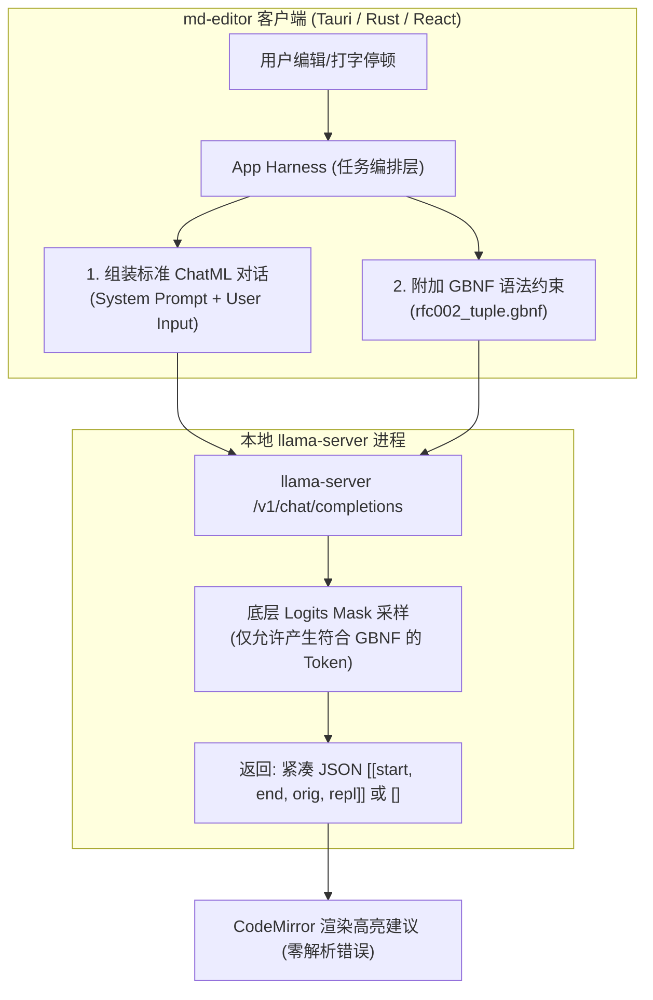

# RFC-004: 客户端 App Harness 编排与双档位 (Gemma 4 Standard + Qwen 3 Lite) 协同规范

> **接收方**：[`wmasfoe/md-editor`](https://github.com/wmasfoe/md-editor) 客户端开发 Agent (Tauri v2 + Rust + React/CodeMirror)  
> **发送方**：[`wmasfoe/md-editor-models`](https://github.com/wmasfoe/md-editor-models) 模型算法与微调工程 Agent  
> **当前状态**：Approved Specification (v1.4.0 Target)  
> **核心原则**：**客户端 App Harness 负责意图引导与 GBNF 物理约束，端侧小模型专注于语义校对，彻底消除过拟合**。

---

## 1. 架构升级背景：为什么从“纯模型指令”转向“App Harness”？

在旧版实现（RFC-002/003）中，客户端仅发送生僻特殊控制符（如 `<|task_gec_zh|>这是一段文本`），没有任何 System Prompt，期望模型仅凭权重记忆直接吐出紧凑元组 JSON。

这一设计在实践中暴露出严重的算法物理局限：
1. **模型过拟合与假阳性（乱报错）**：为了让小模型在“零上下文”下对生僻 Token 形成强反应，LoRA 微调被迫采用高 Epoch 和大学习率，导致基座通用语言注意力被冲垮，模型开始“死记硬背”训练集例句，把许多原本正确的文本强行篡改；
2. **基座迁移成本极高**：每次升级基座（如引入业界顶尖的 Gemma 4），新基座不认识私有控制符，必须重新经历漫长的微调对齐；
3. **输出废话与格式外溢隐患**：若未在采样层强力截断，小模型容易在 JSON 前后输出自然语言客套话（如“好的，我为您纠错如下...”）。

**新架构：App Harness + LLM + GBNF 解耦模型**：



---

## 2. 客户端需配合落地的 5 大核心改造

### 改造一：请求 Prompt 组装（App Harness ChatML 规范）

客户端调用本地 GEC（语法与拼写纠错）时，**不再发送裸控制符 `<|task_gec_*|>`**，而是按标准 ChatML 结构发送包含 `system` 与 `user` 的对话：

#### 1. 语法纠错（GEC - 中文/英文/混排统一）
* **System Prompt**：
  ```text
  你是一个 Markdown 语法与错别字纠错器。找出文本中的错别字与修改建议，仅输出紧凑 JSON 格式 [[start, end, "原词", "建议词"]]。区间 [start, end] 严格以用户提供的待检文本首字符为 0 索引计数。如果文本完全无错，严格仅输出 []，禁止输出任何分析或多余文字。
  ```
* **User Prompt**（直接传输待检文本，严禁添加任何额外前缀，彻底避免字符坐标偏移）：
  ```text
  ${targetText}
  ```

#### 2. 行内续写（Completion / Inline Ghost Text）
* **Lite 档 (Qwen 3 0.6B)**：
  - **建议协议**：继续使用 **`/completion` 原生 FIM 裸流式补全**（无需 LoRA，直接走原生 Base，或在 Adapter 架构下将 LoRA scale 设为 `0.0`），首字响应仅 **15~25ms**：
    ```text
    <|fim_prefix|>${prefix}<|fim_suffix|>${suffix}<|fim_middle|>
    ```
* **Standard 档 (Gemma 4 E2B)**：
  - 由于 Gemma 4 缺少 Qwen 私有 FIM Token，统一采用 **`/v1/chat/completions` 的 App Harness 协议**：
    - **System Prompt**：
      ```text
      你是一个无缝文本续写引擎。请根据用户提供的光标前文（以及可选的光标后文），直接输出接下来自然的续写内容。严禁输出任何解释、说明、前缀或 Markdown 引号包裹，直接输出纯续写正文。
      ```
    - **User Prompt**：
      ```text
      【光标前文】
      ${cursorBefore}
      【光标后文】
      ${cursorAfter}
      ```

#### 3. 文档提炼（Distill）
* **System Prompt**：
  ```text
  你是一个高密度文档提炼助手。提取文章的核心主旨与关键专有名词，严格控制在 150 字以内。
  ```
* **User Prompt**：
  ```text
  【文档标题】${title}
  【章节大纲】${outline}
  【正文内容】
  ${fullMarkdownContent}
  ```

---

### 改造二：挂载 GBNF 语法物理硬约束（语法围栏）

在调用 `llama-server` 的 `/v1/chat/completions` 或 `/completion` 时，必须传递 `grammar` 参数。

#### 标准 RFC-002 紧凑元组 GBNF 定义
客户端可将以下内容固化为本地静态资源（或在调用时直接通过请求体 `grammar` 字段传入）：

```ebnf
root ::= ws "[" ws (tuple (ws "," ws tuple)*)? ws "]" ws
tuple ::= "[" ws int ws "," ws int ws "," ws string ws "," ws string ws "]"
int ::= [0-9]+
string ::= "\"" char* "\""
char ::= [^"\\\x00-\x1F] | "\\" (["\\/bfnrt] | "u" [0-9a-fA-F] [0-9a-fA-F] [0-9a-fA-F] [0-9a-fA-F])
ws ::= [ \t\n\r]*
```

> [!IMPORTANT]
> **GBNF 核心价值**：
> 在 llama.cpp 的 Logits 采样阶段，GBNF 状态机会强制屏蔽所有不符合元组 JSON 的 Token 概率。模型**在物理层面上绝对无法输出中文闲聊或非法字符**，只会直接返回合法 JSON 数组或 `[]`（无错）。

---

### 改造三：双档位模型矩阵更新（Standard 接入 Gemma 4，Lite 保持极轻）

在客户端 `manifest.json` 与模型管理界面中，双档位定义调整如下（正式发布产物保证 100% 具备 `sha256` 与 `downloadUrl` 字段）：

```json
{
  "version": "1.4.0",
  "updatedAt": "2026-10-25T16:50:00Z",
  "contextSize": 8192,
  "models": [
    {
      "modelId": "md-editor-writer-lite",
      "tier": "lite",
      "displayName": "Lite (Qwen 3 0.6B)",
      "description": "极速轻量档：内存占用 <300MB，首字延迟 <30ms，适合老旧轻薄本与快速输入",
      "recommended": true,
      "base": {
        "id": "qwen3-0.6b-base",
        "filename": "lite-base-qwen3-0.6b-v1.4.0-Q8_0.gguf",
        "quant": "Q8_0",
        "sizeBytes": 639000000,
        "sha256": "e3b0c44298fc1c149afbf4c8996fb92427ae41e4649b934ca495991b7852b855",
        "downloadUrl": "https://github.com/wmasfoe/md-editor-models/releases/download/v1.4.0/lite-base-qwen3-0.6b-v1.4.0-Q8_0.gguf"
      },
      "capabilities": {
        "gec": {
          "adapterId": "qwen3-0.6b-gec",
          "filename": "lite-gec-qwen3-0.6b-v1.4.0-lora-f16.gguf",
          "sizeBytes": 28000000,
          "sha256": "cbf529a4d5fca1687a31d0f6644d6f14c4e36124c6b017414c6cf4c1cc35b214",
          "downloadUrl": "https://github.com/wmasfoe/md-editor-models/releases/download/v1.4.0/lite-gec-qwen3-0.6b-v1.4.0-lora-f16.gguf",
          "promptProtocol": "harness-chatml-v1",
          "grammar": "rfc002_tuple"
        }
      }
    },
    {
      "modelId": "md-editor-writer-standard",
      "tier": "standard",
      "displayName": "Standard (Google Gemma 4 E2B)",
      "description": "高精度专业档：Google Gemma 4 端侧基座，原生推理与长句逻辑极强，无错识别率接近 100%",
      "recommended": false,
      "base": {
        "id": "gemma4-e2b-base",
        "filename": "standard-base-gemma4-e2b-v1.4.0-Q4_K_M.gguf",
        "quant": "Q4_K_M",
        "sizeBytes": 1680000000,
        "sha256": "4b227777d4dd1fc61c6f884f48641d02b4d121d3fd328cb08b5531fcacdabf8a",
        "downloadUrl": "https://github.com/wmasfoe/md-editor-models/releases/download/v1.4.0/standard-base-gemma4-e2b-v1.4.0-Q4_K_M.gguf"
      },
      "capabilities": {
        "gec": {
          "adapterId": null,
          "filename": null,
          "sizeBytes": 0,
          "sha256": "",
          "downloadUrl": "",
          "promptProtocol": "harness-chatml-v1",
          "grammar": "rfc002_tuple"
        }
      }
    }
  ]
}
```

> [!TIP]
> **Standard 档位重大突破**：
> `capabilities.gec.adapterId = null`。由于 Gemma 4 E2B 原生语言能力极其强劲，配合客户端 App Harness 的 System Prompt + GBNF，**无需加载任何 LoRA 适配器（零微调原生接入）**！
> 客户端启动 Standard 档位时只需运行原生基座：`llama-server -m standard-base-gemma4-e2b-v1.4.0-Q4_K_M.gguf`。

---

### 改造四：客户端与 `llama-server` 进程参数对接细节 (彻底关闭思考模式)

为避免 Qwen 3 和 Gemma 4 的默认思考模式（Thinking Mode）耗尽 max_tokens 导致正文截断或干扰首 Token 概率分布，进程启动与请求体均需做明确硬关闭：

#### 1. Standard 档位 (`gemma-4-E2B-it`) 启动参数
```bash
llama-server \
  -m models/standard-base-gemma4-e2b-v1.4.0-Q4_K_M.gguf \
  --port 8080 \
  --ctx-size 8192 \
  --jinja \
  --reasoning-budget 0 \
  --n-gpu-layers 99
```
* **不需要**传递 `--lora` 参数；
* 加上 `--reasoning-budget 0` 彻底关停思维链先验；
* 建议开启 `--jinja`，以获得 Gemma 4 原生最佳 ChatML 格式解析。

#### 2. Lite 档位 (`Qwen3-0.6B`) 启动参数
```bash
llama-server \
  -m models/lite-base-qwen3-0.6b-v1.4.0-Q8_0.gguf \
  --lora models/lite-gec-qwen3-0.6b-v1.4.0-lora-f16.gguf \
  --port 8080 \
  --ctx-size 8192 \
  --reasoning-budget 0 \
  --n-gpu-layers 99
```

---

### 改造五：HTTP 请求 Payload 规范样例

客户端通过 Rust 或前端 HTTP Client 发送如下 POST 请求至 `http://127.0.0.1:8080/v1/chat/completions`：

```json
{
  "messages": [
    {
      "role": "system",
      "content": "你是一个 Markdown 语法与错别字纠错器。找出文本中的错别字与修改建议，仅输出紧凑 JSON 格式 [[start, end, \"原词\", \"建议词\"]]。区间 [start, end] 严格以用户提供的待检文本首字符为 0 索引计数。如果文本完全无错，严格仅输出 []，禁止输出任何分析或多余文字。"
    },
    {
      "role": "user",
      "content": "今天我们因该去公园散步。"
    }
  ],
  "chat_template_kwargs": {
    "enable_thinking": false
  },
  "grammar": "root ::= ws \"[\" ws (tuple (ws \",\" ws tuple)*)? ws \"]\" ws\ntuple ::= \"[\" ws int ws \",\" ws int ws \",\" ws string ws \",\" ws string ws \"]\"\nint ::= [0-9]+\nstring ::= \"\\\"\" char* \"\\\"\"\nchar ::= [^\"\\\\\\x00-\\x1F] | \"\\\\\" ([\"\\\\/bfnrt] | \"u\" [0-9a-fA-F] [0-9a-fA-F] [0-9a-fA-F] [0-9a-fA-F])\nws ::= [ \\t\\n\\r]*",
  "temperature": 0.0,
  "max_tokens": 128,
  "stream": false
}
```

#### 预期响应解析（客户端逻辑保持 100% 兼容）
```json
{
  "choices": [
    {
      "message": {
        "role": "assistant",
        "content": "[[4, 6, \"因该\", \"应该\"]]"
      }
    }
  ]
}
```
客户端直接使用现有的 `JSON.parse(content)` 即可无缝处理，原有 CodeMirror 装饰器高亮逻辑 **0 改动**！

---

## 3. 客户端验收测试集 (Acceptance Test Suite)

客户端 Agent 在完成 App Harness 接入后，运行以下 5 组基准用例进行验收：

| 编号 | 测试场景 | 待检文本 (User Prompt) | 期望输出 | 验收关注点 |
| :--- | :--- | :--- | :--- | :--- |
| **TC-1** | 拼音近音误选 | `今天我们因该去公园散步。` | `[[4, 6, "因该", "应该"]]` | 准确识别拼音输入法候选词错误 |
| **TC-2** | 技术术语混淆 | `后端服务的布署配置已经完成。` | `[[5, 7, "布署", "部署"]]` | 针对技术术语的形近/同音校准 |
| **TC-3** | 英文参数拼写 | `接口调用的 paramater 参数需要重新核对。` | `[[6, 15, "paramater", "parameter"]]` | 中英混排下英文专业词纠错（区间 `[6, 15]` 对应字符 `paramater`） |
| **TC-4** | 技术文档无错负样本 | `我们在项目中使用了 LoRA 微调和 Q4_K_M 量化的 GGUF 模型。` | `[]` | **抗过拟合核心检验**：严禁把 LoRA/GGUF 等专业词当成错字篡改 |
| **TC-5** | 正常散文无错负样本 | `这是一篇完全写对的学术论文引言，没有任何语病和错字。` | `[]` | **克制力核心检验**：面对完全正确句子，模型坚决返回 `[]`，不生造错误 |

> [!NOTE]
> **坐标计算与客户端兜底建议**：
> 1. User Prompt 中直接发送纯待检文本（不带“请检查以下文本：”前缀），消除模型对前缀计数的歧义；
> 2. 客户端在 `resolveTripleDefenseDiffs` 中增强容错（当精确区间未命中但 `original` 字符串非空时，自动回退到全文唯一匹配 / 最近邻文本锚点定位），可实现对任意小模型的绝对坐标鲁棒性。

---

## 4. 总结

通过本次 App Harness 升级：
1. **彻底解决过拟合**：Standard 档位无需微调，纯原生 Gemma 4 配合 GBNF 直接释放顶尖水平；
2. **协议高度稳定**：后续更换或升级更大参数模型时，客户端 Harness 协议保持不变，不再受限于特定 Special Token 绑定；
3. **客户端改动极小**：仅需在发起请求时封装标准 System Prompt 并携带已有的 GBNF 语法规则，下游解析与渲染逻辑完全无需变更。
